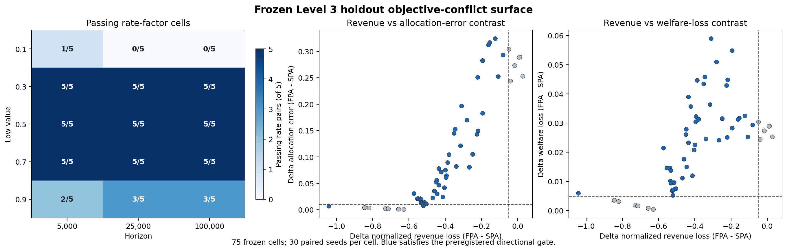

# Level 3 final status

Finalized 2026-09-17. **Overall Level 3 verdict: MIXED (promising phenomenon with substantial literature overlap).** The frozen holdout gate itself is **PASS**. This report does not alter historical Level 2 (`MIXED`) or M2.5 (`CERTIFIED`).

## Frozen question and candidate

The protocol was frozen as SHA-256 `94dcd343a5ac18faa3ebedcbd494a11a574dd236c58351c1a20ba6d57af7f438`. The primary candidate was frozen in commit `241577f`: under persistent asymmetric values and finite-horizon Hedge adaptation, FPA can be more revenue-robust relative to the common competitive benchmark while SPA is more allocation-efficient and welfare-preserving. No candidate, threshold, grid cell, seed, metric, or analysis rule was changed after the freeze.

The directional holdout gate required at least one frozen cell with full-horizon Delta normalized revenue loss at most `-.05` (FPA revenue advantage), paired 95% CI below zero, and either Delta allocation error at least `.01` or Delta welfare loss at least `.005` (SPA advantage), with the corresponding paired 95% CI above zero.

## Development result (exploratory; reported separately)

Development evaluated 1,800 paired cells (3,600 mechanism rows). The selected development cell was `v_L=.2`, `H=10,000`, `(c_H,c_L)=(.5,1)`, step `.01`, with 30 paired seeds:

| Contrast (FPA - SPA) | Mean | Paired 95% CI |
|---|---:|---:|
| Normalized revenue loss | `-.662153` | `[-.663931, -.660374]` |
| Allocation error | `.012983` | `[.012544, .013423]` |
| Welfare loss | `.010387` | `[.010035, .010738]` |

Only candidate class C3 (objective conflict) fired. This development evidence selected the candidate; it is not pooled with holdout evidence.

## Falsification result

All eight preregistered attacks passed: independent seeds, `.005` bid grid, valuation perturbation, joint rate scales `.8` and `1.25`, doubled horizon, and tail shares `.05` and `.20`. The central independent-seed test estimated Delta normalized revenue loss `-.663314` (95% CI `[-.664752,-.661876]`), Delta allocation error `.013118` (`[.012888,.013348]`), and Delta welfare loss `.010494` (`[.010310,.010679]`). Evidence: `results/level_03/falsification/summary.csv` and `verdict.json`.

## Holdout execution integrity

The first 12-worker all-or-nothing attempt ended in `BrokenProcessPool` and preserved zero auditable rows. Commit `e40e044` introduced deterministic paired IDs, immediate atomic pair writes, atomic checkpoints, idempotent skipping, deterministic sharding, and pool reconstruction. The recovery run used two workers and the unchanged frozen holdout.

| Integrity check | Result |
|---|---:|
| Expected paired cells | 2,250 |
| Unique valid paired records | 2,250 |
| Mechanism rows | 4,500 |
| Duplicate paired IDs / rows | 0 / 0 |
| Missing / corrupt / unexpected pairs | 0 / 0 / 0 |
| Seed range | 2000--2029 |
| Pool failures / restarts | 0 / 0 |
| Logical auction rounds | 195,000,000 |

The grid SHA-256 is `5b65a1c9ee21e89484b93c43df5706ed35138c67be84234d75d7deffea6d4729`, matching the frozen file. All rows carry the frozen protocol hash and runner commit `e40e044`. The completed runner stderr is empty.

## Holdout result (confirmatory; not pooled with development)

**The frozen holdout gate passes.** Of 75 environment cells (five valuations x three horizons x five rate-factor pairs), 54 meet the full directional objective-conflict gate. Sixty-eight cells meet the FPA-revenue component; 50 meet the allocation-error component jointly with it; 54 meet the welfare component jointly with it. Passing cells include all five holdout valuations and all three horizons. The homogeneous rate pair passes in 11 of 15 valuation-horizon cells.

The strongest joint-magnitude passing cell is `v_L=.1`, `H=5,000`, `(c_H,c_L)=(.5,1)`, step `.01`, 30 paired seeds:

| Contrast (FPA - SPA) | Mean | Paired 95% CI | Gate role |
|---|---:|---:|---|
| Normalized revenue loss | `-1.042577` | `[-1.046347,-1.038807]` | FPA revenue advantage |
| Allocation error | `.006593` | `[.006190,.006996]` | Below the `.01` allocation floor |
| Welfare loss | `.005934` | `[.005571,.006297]` | SPA welfare advantage; exceeds `.005` |

The holdout conclusion does not depend on this strongest cell alone: 54 independently defined frozen environment cells satisfy the same prespecified union rule. The complete cell classification is `results/level_03/holdout/analysis/primary_candidate_cell_classification.csv`; the exact machine-readable verdict is `primary_candidate_verdict.json`.

## Adjudication

- **Candidate survival:** PASS. The immutable C3 revenue-efficiency conflict survives all falsification attacks and the independent frozen holdout.
- **Holdout:** PASS. The preregistered directional/economic/significance gate is met without tuning.
- **Novelty:** SUBSTANTIAL OVERLAP. The committed pre-holdout audit found the broad FPA/SPA revenue contrast, SPA runner-up shading, learning-rate effects, and adjacent welfare results strongly anticipated by prior work.
- **Overall Level 3:** **MIXED**, equivalently a partial/promising computational result rather than a novel-result PASS. The novelty audit explicitly capped the verdict even under perfect survival.

No replacement candidate was selected. No Level 4, Level 5, or mechanism-design work is authorized by this report.

## Reproducible artifacts

- Frozen protocol/candidate: `docs/level_03_discovery_protocol.md`, `docs/level_03_primary_candidate_selection.md`
- Pre-holdout novelty audit: `docs/level_03_targeted_novelty_audit.md`
- Recovery method: `docs/level_03_holdout_recovery_protocol.md`
- Holdout manifest/checkpoint: `results/level_03/holdout/manifest.json`, `checkpoint.json`
- Mechanism rows: `results/level_03/holdout/seed_results.csv`
- Paired rows/cells: `results/level_03/holdout/analysis/paired_seed_differences.csv`, `paired_cell_summary.csv`
- Frozen-gate output: `results/level_03/holdout/analysis/primary_candidate_verdict.json`
- Figure: `results/level_03/holdout/analysis/objective_conflict_surface.png`
